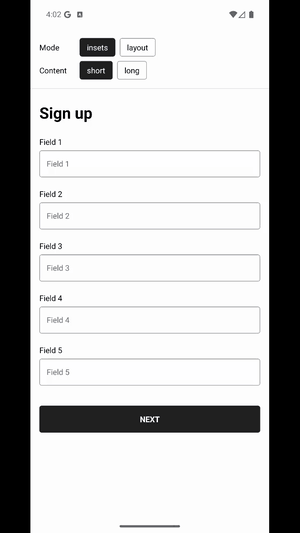

## Reproducible for `KeyboardAwareScrollView` scrolling past its end on Android

On Android, with the keyboard open, the first slow upward drag scrolls a short form far past its end. When the finger lifts, the form jumps back to its end in one frame.



The same recording as a video, to step through frame by frame: [media/overscroll.mp4](media/overscroll.mp4)

### Versions

- Expo SDK 58 (`expo` 58.0.20)
- React Native 0.88.0, new architecture
- `react-native-keyboard-controller` 1.22.9
- `react-native-reanimated` 4.7.1, `react-native-worklets` 0.13.0
- Pixel 9 Pro emulator, Android 16 (API 36)

### Run

The app needs a development build, because Expo Go can't load a pinned keyboard-controller version.

```sh
npm install
npm run android
```

### Steps

1. Open the app. It starts on **Mode: insets** and **Content: short**.
2. Tap **Field 1**. The keyboard opens. Don't scroll first.
3. Put a finger on the form and drag it slowly upward. Keep the finger down.
4. Lift the finger.
5. Drag upward again.

### Expected

In step 3, the form scrolls until the NEXT button sits just above the keyboard, then stops.

### Actual

- In step 3, the form keeps scrolling with the finger past its end. The NEXT button moves toward the top of the screen and empty space opens below it.
- In step 4, the form jumps back to its end in one frame.
- In step 5, the form stops at its end, as expected.

### Switches

- **Mode** sets the `mode` prop of `KeyboardAwareScrollView`.
  - `insets`, the library default, shows the bug.
  - `layout` doesn't show it.
- **Content** sets the form's length.
  - `short` fits the scroll view without the keyboard and overflows it with the keyboard. It shows the bug.
  - `long` overflows the scroll view even without the keyboard. It doesn't show the bug.

Changing a switch remounts the scroll view, so each setup starts at scroll position 0. Close the keyboard before you change a switch, then start again from step 2.
